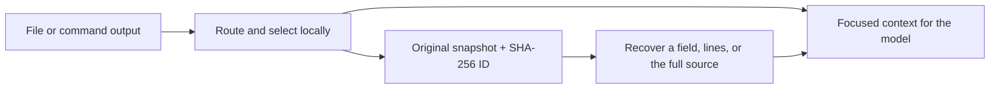

# TokenLoom

**Give your agent the context it needs. Keep the original within reach.**

[](https://github.com/blainelynn/tokenloom/releases)
[](LICENSE)
[](package.json)

Local context compression, targeted retrieval, and verifiable recovery for **Codex**, plus lightweight concise-answer instructions for **ChatGPT**. No model API key is needed for local compression.

**Up to 96.67% less supplied context in the two published examples.** A small live Codex pilot also used **13.16%–13.77% fewer reported input + output tokens**, with matching correct answers in both pairs.

[Quick start](#quick-start) · [Measured results](#measured-results) · [MCP setup](docs/USAGE.md) · [Download](https://github.com/blainelynn/tokenloom/releases) · [Methodology](docs/BENCHMARKS.md)

## Measured results

### Send a focused result instead of the entire file

Both examples use the same 120-record JSON fixture. Counts include the returned selection envelope, source ID, and accompanying context.

| Successful example | Full-file context | Supplied context with TokenLoom | Context reduction |
|---|---:|---:|---:|
| Record lookup + full-array count | 2,522 tokens | 191 tokens | **92.43%** |
| Retrieve one field from the saved snapshot | 2,522 tokens | 84 tokens | **96.67%** |

Local counts use `o200k_base`. Selection intentionally omits unrelated records; the full original stays available through its recovery ID.

### Live Codex pilot: same questions, matching answers

| Successful QA pair | Baseline input + output | TokenLoom input + output | Reduction | Answer check |
|---|---:|---:|---:|---|
| Record lookup + count | 17,715 | 15,384 | **13.16%** | Both correct |
| Recovered field lookup | 17,710 | 15,272 | **13.77%** | Both correct |

Four calls, two paired tasks, one run per arm, `gpt-6-astra`, low reasoning effort. These are reported successful-turn tokens, including the host context visible in usage. Retry consumption is not independently observable. Retrieval was prepared before each call; this pilot does not measure autonomous tool selection or an entire agent session. Results are examples, not a general savings guarantee or a ChatGPT billing estimate. [Evidence and reproduction](docs/BENCHMARKS.md).

## What makes it useful

| Capability | What it does |
|---|---|
| Automatic format routing | Handles JSON, JSONL, CSV, and opt-in TAP/log reduction; preserves unknown formats. |
| Precise selection | Literal search, line ranges, JSON Pointer, record filters, pagination, and local full-array counts. |
| Recoverable context | Stores the original locally with a SHA-256 ID; retrieves the whole snapshot or just a field. |
| Measured output | Counts complete returned text, including selection metadata; avoids expanding ordinary compacted output. |
| Codex tools | Provides a local MCP server and a shell-free command wrapper with bounded output and timeouts. |
| Usage ledger | Tracks supplied fragments, recovery overhead, and observed model usage separately; deduplicates consistent records. |
| Lightweight instructions | A Codex skill and English ChatGPT custom instructions encourage concise answers and deliberate reading. |



## Quick start

Requires Node.js 22+ and pnpm 11.25.0.

```sh
git clone https://github.com/blainelynn/tokenloom.git
cd tokenloom
pnpm install --frozen-lockfile

# Automatically compact a supported file
node src/cli.js read data.json --root /absolute/workspace

# Read only the matching lines and nearby context
node src/cli.js read app.log --root /absolute/workspace --query "timeout" --budget 600

# Count the entire JSON array locally
node src/cli.js read records.json --root /absolute/workspace --count

# Fetch a precise JSON value, preserving its original number spelling
node src/cli.js read records.json --root /absolute/workspace --pointer /73/timeout_seconds
```

Replace the example filenames and workspace path with your own. On Windows, use paths such as `E:/my-project`.

### Codex

Install the optional skill:

```sh
node scripts/install-codex.mjs
```

Start a new Codex chat and invoke `$tokenloom`. For file retrieval and recovery, configure the local MCP server using the [setup guide](docs/USAGE.md). Installing the skill alone does not start the server.

### ChatGPT

Copy [the English custom instructions](integrations/chatgpt/custom-instructions.en.txt) into your ChatGPT custom instructions. You can also compact files locally and provide the resulting text to ChatGPT.

The optional skill/plugin archive is for clients that support that installation format. The local stdio MCP server needs a compatible host; this release does not provide a hosted ChatGPT connector. These integrations act on the content you route through them.

## Reproduce the results

```sh
pnpm check
node scripts/v04-evaluation.mjs
```

The default evaluation runs locally with no model call. To reproduce the four-call live pilot using an authenticated Codex CLI, explicitly opt in:

```sh
node scripts/v04-evaluation.mjs --live
```

Live evaluation consumes your model usage. See [the benchmark guide](docs/BENCHMARKS.md) for controls and the distinction between local counts and provider usage.

## Build and contribute

```sh
python scripts/package.py
```

Python 3.10+ creates source, Codex skill, and ChatGPT plugin ZIPs with SHA-256 checksums in `dist/`. The source archive includes the runtime; the skill/plugin archives contain instructions only. Dependencies are installed separately.

See [contributing](CONTRIBUTING.md), [security and operating limits](SECURITY.md), and [v0.4.0 release notes](docs/RELEASE-v0.4.0.md). Development and historical research notes in Chinese remain available under `docs/`.

## Credits and license

Original JavaScript implementation, released under the [MIT license](LICENSE). We studied [Caveman](https://github.com/JuliusBrussee/caveman), [Downshift](https://github.com/tiagovilasboas/downshift), [RTK](https://github.com/rtk-ai/rtk), and context-compression research. No upstream compressor source was copied into this release. [Attribution and pinned research](NOTICE.md).

TokenLoom is an independent project and is not affiliated with OpenAI or the projects above.
